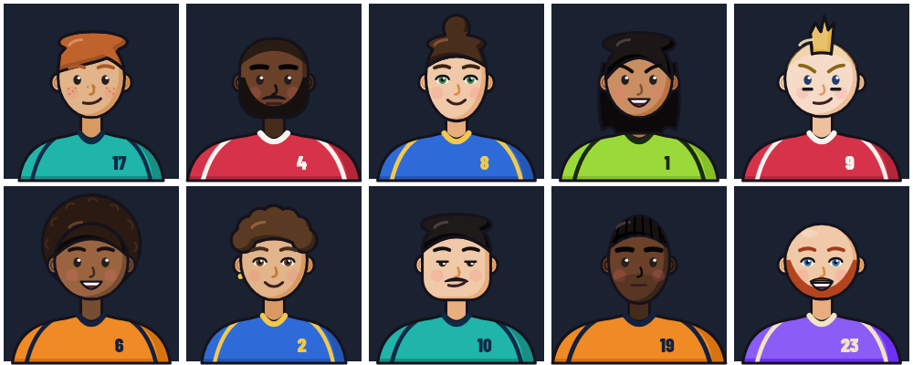
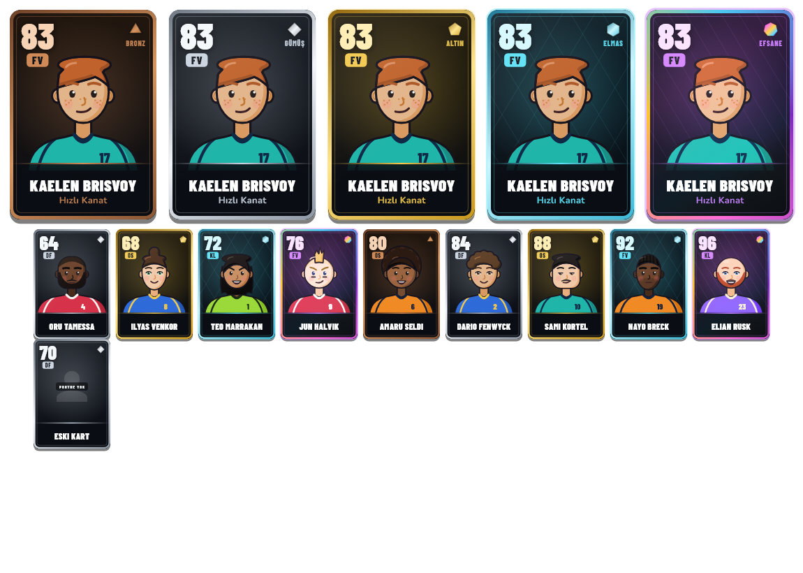
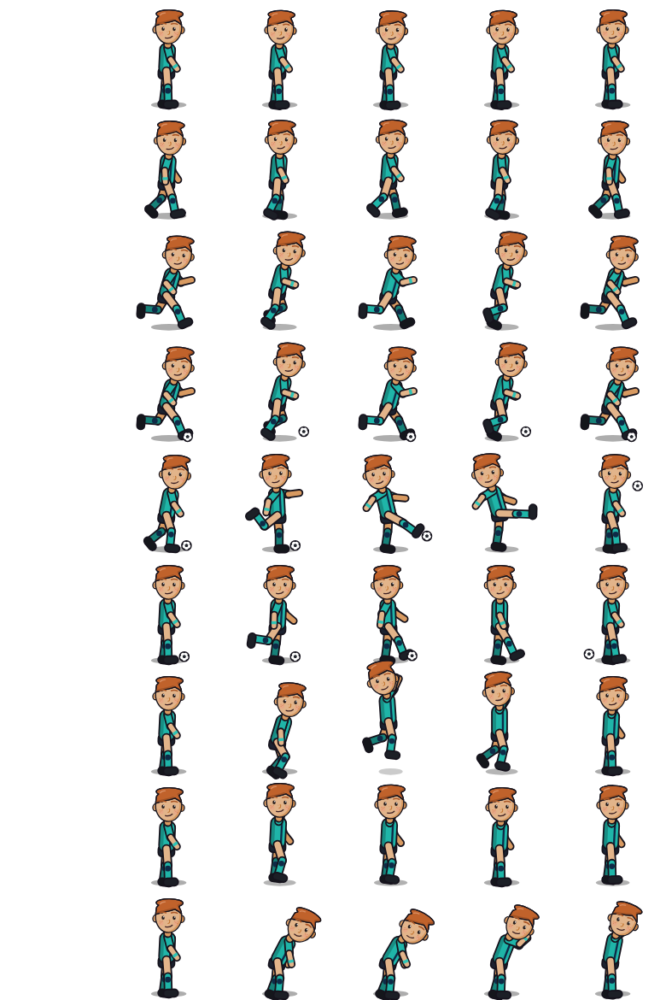
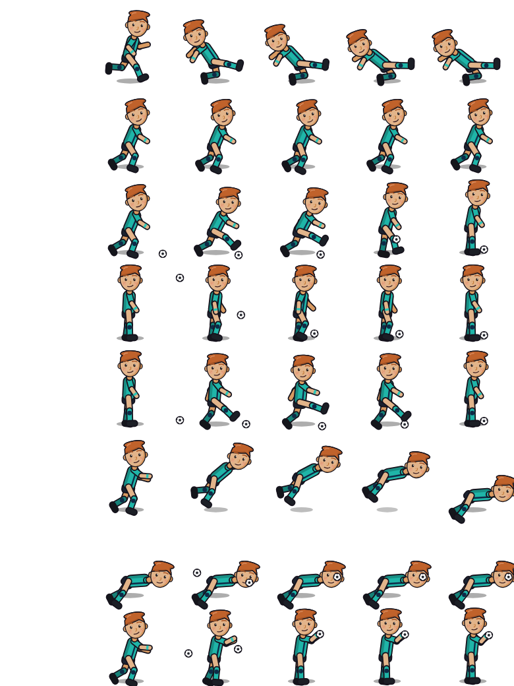
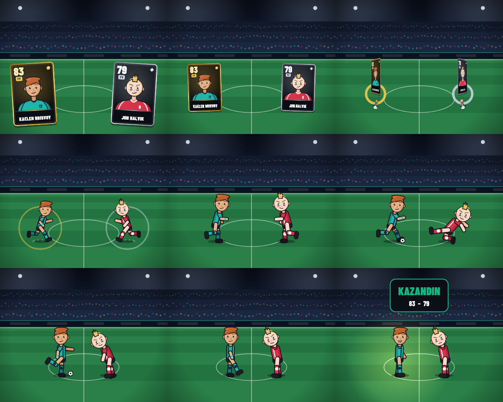
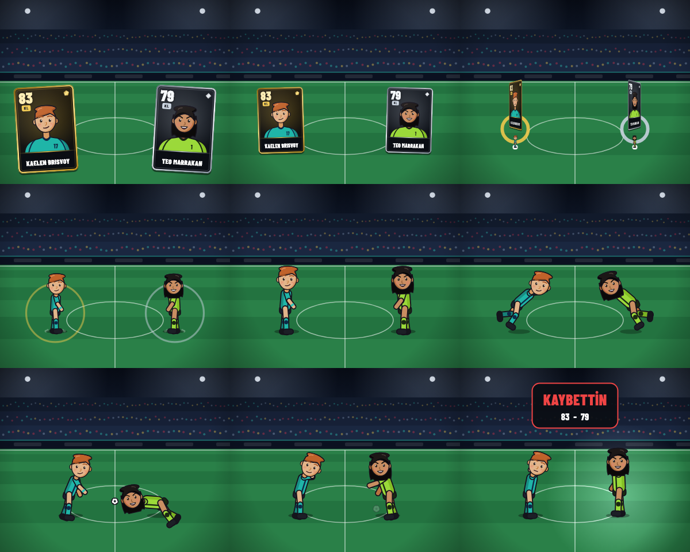

# Futbol Card Arena — Yeni Görsel Yön: Stilize 2D

> Durum: **prototip**. Tek karakter (Kaelen Brisvoy) üzerinden kart, detay ve
> arena animasyonu çalışıyor. Oyunun canlı ekranları (maç, koleksiyon, paket)
> **değişmedi**; hâlâ eski `PremiumPlayerCard` ve 2.5B `ClashScene` kullanılıyor.
>
> Uygulamada görmek için: **Ayarlar → Geliştirici → 2D stil prototipi**
> (`/ayarlar/stil-prototipi`).

Bu belgedeki bütün görseller **uygulamanın kendi kodunun çıktısıdır**
(`docs/gorsel_2d/`, test ortamında çizilip kaydedildi). Hiçbiri elle çizilmiş,
yapay zekâyla üretilmiş ya da temsili bir görsel değildir.

---

## 1. 2D karakter sanat yönü

**Ana fikir:** Karakter yüzü bir resim dosyası değil, bir **parametre listesi**
(`AvatarSpec`): ten, kafa şekli, saç modeli ve rengi, göz, kaş, ağız, sakal,
aksesuar, vücut yapısı, forma renkleri ve numara. `AvatarDraw` bu listeyi
kodla (vektör) çizer.

Bunun getirdikleri:

- Ücretli görsel üretimi, lisans veya telif riski yok.
- Kart, detay ve arena **aynı tanımdan** çizilir. Karakter karttan sahaya
  geçtiğinde yüzü birebir aynı kalır.
- Her boyutta keskin görünür ve uygulama boyutunu büyütmez.
- Bir karakterin görünüşü tek bir JSON satırıdır (bkz. bölüm 9).

**Stil kuralları** (`lib/shared/widgets/avatar2d/avatar_painter.dart`):

| Kural | Uygulama |
|---|---|
| Düz renk + tek gölge tonu | Degrade yok. Gölge, sağ-alt tarafta tek bir hilal. |
| Ortak kalın kontur | Her ana şeklin etrafında aynı koyu çizgi (`#15121C`) var; bu çıkartma hissi verir. |
| Büyük kafa, basit yüz | Gözler nokta, burun tek çizgi, ağız kısa bir eğri. |
| Işık sol üstten | Saç parlaması sol üstte, gölgeler sağ altta. |
| Gerçek insana benzemez | Fotoğraf dokusu, gerçekçi oran ve gerçek kişi yüzü yok. |
| Ayırt edilebilirlik | Önce siluet ayırt edilmeli (saç modeli, kafa şekli, sakal), sonra renk. |

**Seçenek uzayı:**

- 6 ten tonu, 4 kafa şekli, 10 saç modeli
- 3 göz, 3 kaş ve 4 ağız tipi
- 4 sakal tipi, 4 yüz aksesuarı
- 3 vücut yapısı, bileklik ve forma renkleri

Bu, on binlerce ayırt edilebilir birleşim demek.



## 2. Kart bileşen sistemi

`ArenaCard` (`lib/shared/widgets/arena_card/arena_card.dart`) sabit yuvalardan
oluşur. Yuvaların yeri her boyutta aynıdır:

| Yuva | İçerik |
|---|---|
| Sol üst | **Güç** (büyük, Barlow Condensed) ve altında **mevki etiketi** (vurgu zeminli) |
| Sağ üst | **Nadirlik taşı** ve nadirlik adı |
| Orta | **2D göğüs portresi** |
| Alt | Vurgu çizgisi, **karakter adı** (sığmazsa küçülür, kesilmez) ve alt satır (oyun tarzı veya kulüp) |

**Boyut sınıfları:**

| Sınıf | Genişlik | Kullanım | Ne gizlenir |
|---|---|---|---|
| Küçük | < 130 px | El, koleksiyon ızgarası | Alt satır, nadirlik adı |
| Normal | 130–219 px | Kadro, paket | — |
| Vitrin | ≥ 220 px | Detay, kart açılışı | — |

**Kurallar:**

- Portre yoksa (`spec: null`) gri siluet ve **"PORTRE YOK"** görünür.
- Efekt animasyonları `animate: false` ile ya da ayarlardaki "Kart
  animasyonları" ile kapanır (listelerde kapalı tutulmalı).
- Ekran okuyucu için ad, mevki, nadirlik ve güç tek etiket olarak okunur.

## 3. 5 nadirlik için kart tasarım sistemi

`RarityStyle` (`rarity_style.dart`). **Zemin her nadirlikte koyudur.**
Nadirlik zeminden değil; çerçeve, vurgu rengi, taş ve efekt üzerinden
anlaşılır. Böylece portre her kartta aynı kontrastla okunur ve 5 nadirlik
tek bir aile gibi görünür.

| Nadirlik | Vurgu | Taş | Efekt | Işık |
|---|---|---|---|---|
| Bronz | bakır `#D08A57` | üçgen | mat (yok) | yok |
| Gümüş | gümüş `#C9D3DF` | kare | sabit üst parlaklık | çok az |
| Altın | altın `#F2C94C` | beşgen | arada bir geçen parlama şeridi | orta |
| Elmas | buz mavisi `#5CE1F5` | altıgen | kesik yüzey çizgileri ve sık parlama | güçlü |
| Efsane | mor `#C77DFF` + çok renk | yedigen | dönen çok renkli çerçeve ve renk kayan zemin | en güçlü |

Taşın köşe sayısı nadirlikle artar. Böylece renk körlüğü olan oyuncu da
nadirliği ayırt edebilir.



*Alt sıradaki küçük kartlardaki güç ve nadirlik değerleri sadece çizim
testidir; bu karakterlerin oyunda değeri yok.*

## 4. 10 örnek stilize futbolcu konsepti

Hepsi **kurgusal**: adlar, kulüpler ve görünüşler özgün. Kaynak:
`concept_characters.dart`.

| # | Ad | Mevki / tarz | Kulüp | Ayırt edici özellik | Durum |
|---|---|---|---|---|---|
| 1 | Kaelen Brisvoy | FV · Hızlı Kanat | Liman Rüzgârı FK | bakır yana taralı saç, çiller, turkuaz bileklik | **Veritabanında (taslak)** |
| 2 | Oru Tamessa | DF · Kurt Stoper | Kuzey Fener SK | kazınmış saç, dolgun sakal, iri yapı | konsept |
| 3 | Ilyas Venkor | OS · Oyun Kurucu | Mavi Koy FK | topuz, saç bandı, yeşil göz | konsept |
| 4 | Teo Marrakan | KL · Çizgi Kalecisi | Bozkır Kartalları | uzun dalgalı saç, keskin kaş | konsept |
| 5 | Jun Halvik | FV · Bitirici Golcü | Kuzey Fener SK | sarı ibik, göz altı boyası | konsept |
| 6 | Amaru Seldi | OS · Box-to-Box | Tepe Yıldızı | afro, kocaman gülüş | konsept |
| 7 | Dario Fenwyck | DF · Hücumcu Bek | Mavi Koy FK | kıvırcık saç, altın küpe | konsept |
| 8 | Sami Kortel | OS · Teknik Orta Saha | Liman Rüzgârı FK | kısa saç, bıyık, uykulu bakış | konsept |
| 9 | Nayo Breck | FV · Hedef Santrafor | Tepe Yıldızı | örgülü saç, kirli sakal, iri yapı | konsept |
| 10 | Elian Rusk | KL · Libero Kaleci | Bozkır Kartalları | saçsız, kızıl sakal | konsept |

Konsept karakterlerin **gücü ve oyunda karşılığı yok**. Oyuna alınmaları için
Denge Motoru'ndan geçmeleri ve onay akışından (`review_character`) geçmeleri
gerekir.

## 5. Mevkilere göre animasyon listesi

17 klip, kodda veri olarak tanımlı (`figure_rig.dart`). Her klip 2–5 anahtar
pozdan oluşur ve 0,6–1,0 saniye sürer.

| Mevki | Kazanırsa | Kaybederse | Berabere |
|---|---|---|---|
| Forvet | koşu, top sürme, **şut**, sevinç | koşu, kayarak müdahale, üzüntü | koşu, top sürme, bekleme |
| Orta saha | top kontrolü, top sürme, **pas**, zafer | top kontrolü, araya girme, üzüntü | top kontrolü, pas, bekleme |
| Defans | savunma duruşu, kayarak müdahale, **top çalma**, zafer | savunma duruşu, kayarak müdahale, üzüntü | savunma duruşu, bekleme |
| Kaleci | bekleme, plonjon, **kurtarış**, zafer | bekleme, plonjon, üzüntü | bekleme, **tutuş**, bekleme |
| Pas geçen | bekleme, üzüntü | — | — |
| Pas geçene karşı | yürüme, zafer | — | — |

Bu dizileri zaten var olan `clipsFor` fonksiyonu veriyor (Aşama A1). Klip
adları 025'teki `animation_clip_requirements` tablosuyla aynı.




*Satırlar sırasıyla: bekleme, yürüme, koşu, top sürme, şut, pas, sevinç,
zafer, üzüntü / kayarak müdahale, savunma duruşu, top çalma, top kontrolü,
araya girme, plonjon, kurtarış, tutuş. Sütunlar klibin %0, 30, 50, 70 ve
100'ündeki pozlar.*

## 6. Karttan sahaya geçiş animasyonu

`DuelStage` (`stage2d/duel_stage.dart`) tek bir `AnimationController` ile
çalışır:

| Süre (1x hız) | Evre | Ne olur |
|---|---|---|
| 0–450 ms | **Giriş** | İki kart alttan hafif yaylanarak girer. |
| 450–950 ms | **Fırlatma** | Kartlar sahadaki yerlerine uçar, küçülür. Son %40'ta Y ekseninde 90° döner ve kenardan görünmez olur. |
| 950–1300 ms | **Belirme** | Kart görünmez olduğu anda figür yaylanarak büyür. Nadirlik renginde ışık halkası ve toz bulutu çıkar. |
| 1300 ms – … | **Aksiyon** | İki taraf mevkiye göre klip dizisini oynar. Figürler ortaya doğru ilerler ama çarpışmaz. |
| … + 1100 ms | **Sonuç** | Kazananın üstüne nadirlik renginde spot düşer, sonuç bandı çıkar (güç - güç), yüz ifadeleri değişir. |

Sahnenin toplamı 6 saniyenin altındadır (test bunu denetler). **Sonucu
animasyon belirlemez**: sonuç sahne açılmadan bellidir (maçta sunucudan
gelir); animasyon yalnızca onu gösterir.




*Kareler: 250, 700, 900, 1080, 1700, 2300, 2900, 3500 ms ve son kare.*

## 7. Arena için sade 2D/2.5D sunum

`SideArenaPainter`: yan görünüm, tek `CustomPainter`, görsel dosyası yok.

- **Üst %40:** gece gökyüzü, iki projektör ışığı, üç katlı tribün silueti ve
  renkli seyirci noktaları.
- **Reklam bandı:** koyu şerit ve turkuaz vurgu çizgisi.
- **Saha:** aşağı doğru kalınlaşan çim şeritleri (2.5D derinlik hissi),
  yassı orta yuvarlak ve orta çizgi.
- **Sonuç anı:** kazananın üstünde yumuşak spot ışığı.

**Neden yan görünüm?** Figürler profilden koşup şut çekince hareket en net
okunur. Eski arka kale görünümü (`ArenaBackdrop`) perspektifli olduğu için
2D figürlerle uyumsuz kalıyordu. Kartlarla aynı düz renkli, konturlu dil
korunuyor; stil bütünlüğü bu yüzden sağlanıyor.

## 8. Flutter animasyon mimarisi

```
AvatarSpec (veri, JSON)
   │
   ├─► AvatarDraw.bust ──► AvatarPortrait ──► ArenaCard (kart, detay)
   │
   └─► AvatarDraw.head ─┐
                         ├─► FigureDraw.paint ──► DuelStage (arena)
Pose ◄─ FigureClip ◄─────┘        ▲
  ▲        (17 klip, anahtar poz)  │
  └─ ClipSequencePlayer ◄── clipsFor(mevki, sonuç)  ◄── sunucunun tur sonucu
```

- **Tek kafa çizimi:** Kart portresi ve arena figürü kafayı aynı
  fonksiyonla (`AvatarDraw.head`) çizer.
- **İskelet:** 11 parça: kalça, gövde, kafa, 2×(üst kol + ön kol),
  2×(uyluk + baldır). `Pose` 16 sayıdır (açılar, kök kayması, topun yeri).
  `FigureGeometry` eklem noktalarını hesaplar.
- **Klipler:** anahtar pozlar arası `easeInOut` ile geçer. Klip
  değişirken ilk %18'lik bölümde önceki pozdan yumuşakça karışır, bu yüzden
  sıçrama olmaz (test edildi).
- **Top:** sadece kazanan tarafta çizilir (beraberlikte bende). Böylece
  ekranda iki top görünmez. Kurtarış ve tutuşta top kalecinin eline
  bağlanır.
- **Performans:** sahnede tek `AnimationController` var. Figürler ve
  arena `CustomPainter`'dır. Kart efektleri sadece altın ve üstünde, sadece
  `animate: true` iken çalışır ve `RepaintBoundary` ile yalıtılır.
- **Erişilebilirlik:** "Kart animasyonları" ayarı kart efektlerini kapatır.
- **Yeni bağımlılık eklenmedi.**

## 9. Mevcut karakter sisteminin revizyonu

| Konu | Eski plan (A1) | Yeni yön | Durum |
|---|---|---|---|
| Portre | Ücretli üretilen PNG (`character_assets.portrait`) | Kodla çizilen `AvatarSpec` | Prototipte yapıldı |
| Arena | 3B glTF ve iskelet, yoksa sprite, yoksa 2.5B | **2D vektör** (`Vector2dRenderer`), yoksa 2.5B | `kRenderers2d` eklendi |
| Animasyon | 3B klip dosyaları, onaylı varlık | Kodda anahtar poz verisi | 17 klip hazır |
| Ücretli üretim | Gerekiyordu (maliyet ve lisans onayı bekliyordu) | **Gerekmiyor** | — |
| Görünüş verisi | Serbest metin (`appearance`: "açık buğday", "bakır") | Yapılandırılmış `avatar_spec` | **Öneri** |

**Önerilen veritabanı değişikliği (yapılmadı, onayını bekliyor). Taslak:
`028_avatar_spec.sql`.**

- `characters` tablosuna `avatar_spec jsonb` sütunu eklenir (biçim
  `AvatarSpec.toJson()` ile aynı). İçeriği şema denetimiyle doğrulanır ve
  onaylı karakterde değiştirilemez (025'teki varlık kilidi gibi).
- `character_presentation.mode` değerlerine `'2d_vector'` eklenir.
- `animation_clip_requirements` kalabilir. 2D'de klipler kodda olduğu için
  "eksik klip" hesabı vektör karakterlerde 0 sayılır.
- İçerik üretim hattına (`packages/content_pipeline`) `avatar_spec` üretme
  ve doğrulama eklenir. Yapay zekâ yine **güç belirleyemez**.

**Bugünkü geçici çözüm:** `resolveAvatar` önce uygulamadaki tasarlanmış
konsepte bakar. Yoksa veritabanındaki serbest metinden **tahmini** bir tanım
üretir. Metinde olmayan özellikler (saç modeli gibi) slug'dan deterministik
seçilir. Detay ekranında hangi kaynağın kullanıldığı açıkça yazılır.

**Değişmeyenler:**

- Oyun mantığı, kurallar, kartlar, sahiplik, desteler ve güçler.
- Maç ekranı (`ClashScene`) ve eski kart (`PremiumPlayerCard`).
- Veritabanı. Bu çalışmada hiçbir migration eklenmedi ya da çalıştırılmadı.

**Önerilen geçiş sırası** (her biri ayrı onayla):

1. `028_avatar_spec` ve içerik hattına avatar üretimi.
2. Koleksiyonda `ArenaCard`. Eski 100 kartın portresi olmadığı için "PORTRE
   YOK" gösterilir ya da onlar için de konsept tanımı üretilir (gerçek
   oyuncuları taklit etmeden).
3. Maç ekranında `ClashScene` yerine `DuelStage`. Önce bir ayar
   bayrağıyla, karşılaştırmalı denemeden sonra.

## 10. Tek karakter prototipi

**Ekran:** Ayarlar → Geliştirici → 2D stil prototipi
(`lib/features/characters/presentation/style_prototype_view.dart`).

| Sekme | İçerik | Veri kaynağı |
|---|---|---|
| **Kart** | Vitrin kartı (gerçek nadirliği altın, efektler açık), 5 nadirlik çerçevesi, boyut sınıfları, portresiz kart örneği | Sunucu: `GET /api/characters/kaelen-brisvoy` |
| **Detay** | Portre, kimlik, mevki, kulüp, 6 özellik çubuğu, döngüde oynayan bekleme ve koşu figürü, kişilik, hikâye, teknik durum | Sunucu ve Denge Motoru önerisi |
| **Arena** | Karttan sahaya düello. Sonuç seçimi (kazanır / kaybeder / berabere), 4 mevki, yavaş çekim, tekrar oynat ve iki tarafın klip listesi | Rakip: aynı mevkiden konsept karakter |
| **Konseptler** | 10 karakter. Sadece Kaelen "TASLAK KAYIT", diğerleri "KONSEPT" | Uygulama içi |

**Ekranda açıkça yazanlar:**

- Sonuç bu önizlemede seçilir; gerçek maçta sunucu belirler.
- Rakibin gücü sadece gösterim içindir.
- Kaelen taslaktır ve oyunda değildir.

## Doğrulama

- `test/stil_2d_test.dart`: 20 test, hepsi geçti. Kapsadıkları:
  - JSON gidiş-dönüşü
  - Serbest metinden tahmin
  - 5 nadirlik × 3 boyutta taşma olmaması
  - Her klibin varlığı ve anahtar poz sırası
  - Klip geçişinde sıçrama olmaması
  - Topun eldeki konumu
  - 4 mevki × 3 sonuçta sahnenin baştan sona oynaması
  - Prototip ekranının dört sekmesi
- Görseller test ortamında gerçek yazı tipleriyle çizildi
  (`docs/gorsel_2d/`).
- Yerel uygulamada (web) prototip ekranı sunucudan gelen gerçek veriyle
  açıldı; arena sahnesi sonuç bandına kadar oynadı.

## Yapılmayanlar / sınırlar (dürüst liste)

- **Canlı oyun ekranları değişmedi.** Yeni kart ve arena sadece prototip
  ekranında.
- **Figürler basit.** Gövde profilden, yüz izleyiciye dönük çiziliyor
  (chibi tarzı). İki kalecinin birbirine doğru plonjon yapması gibi
  sahneleme tuhaflıkları var.
- **Ayaklar her pozda zemine tam oturmuyor.** Ters kinematik yok.
- **Animasyon değerleri elle ayarlandı.** Animatör elinden geçmedi.
- **Ses ve titreşim yok.**
- **Veritabanında `avatar_spec` yok.** Kaelen'in görünüşü uygulama içindeki
  konsept tanımından geliyor.
- **Diğer 9 karakter yalnızca konsept.**
